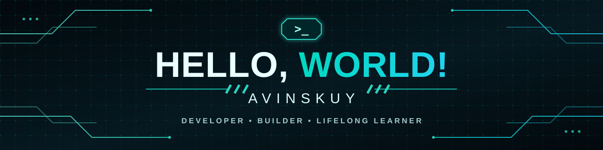
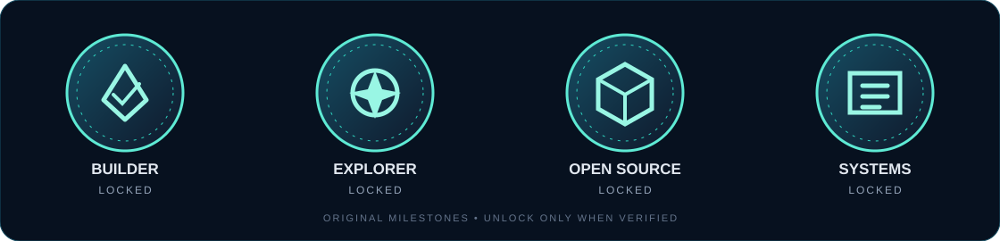
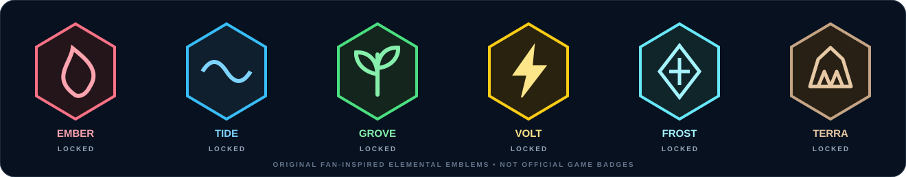

  

  <h3>Developer • Builder • Lifelong Learner</h3>

  

  

    &nbsp;&nbsp;
    &nbsp;&nbsp;
    
    &nbsp;&nbsp;
  

---

## $ whoami

<pre><code>&gt; whoami
avinskuy

&gt; focus
building • learning • experimenting

&gt; current_interests
Rust / backend systems / web development / security</code></pre>

I enjoy turning ideas into practical digital products, exploring how systems work, and learning by building. Currently spending time on Rust, backend engineering, and thoughtful product design.

## 🧭 Current focus

- Exploring Rust and systems programming.
- Learning backend engineering and API design.
- Building modern web experiences.
- Exploring application security, automation, and open-source tooling.

## 🧰 Tech stack

<table>
  <tr>
    <td width="50%" valign="top">
      <strong>Languages</strong> 
      
    </td>
    <td width="50%" valign="top">
      <strong>Frontend</strong> 
      
    </td>
  </tr>
  <tr>
    <td width="50%" valign="top">
      <strong>Backend & Data</strong> 
      
    </td>
    <td width="50%" valign="top">
      <strong>Tools & Infrastructure</strong> 
      
    </td>
  </tr>
</table>

## 🏅 Badge collection

<strong>Developer achievements</strong>

  

<strong>Elemental gym badges</strong>

  

  All badges start locked. Unlocks will only be shown after the related milestone is verified. Gym designs are original fan-inspired artwork, not official Pokémon assets.

## 📊 GitHub stats

  
  

  

## 🧊 Contribution landscape

  

## 🐍 Contribution snake

  <picture>
    <source media="(prefers-color-scheme: dark)" srcset="https://raw.githubusercontent.com/avinskuy/avinskuy/output/github-contribution-grid-snake-dark.svg" />
    <source media="(prefers-color-scheme: light)" srcset="https://raw.githubusercontent.com/avinskuy/avinskuy/output/github-contribution-grid-snake.svg" />
    
  </picture>

---

  Learning in public • Building with purpose • One commit at a time
   
  

